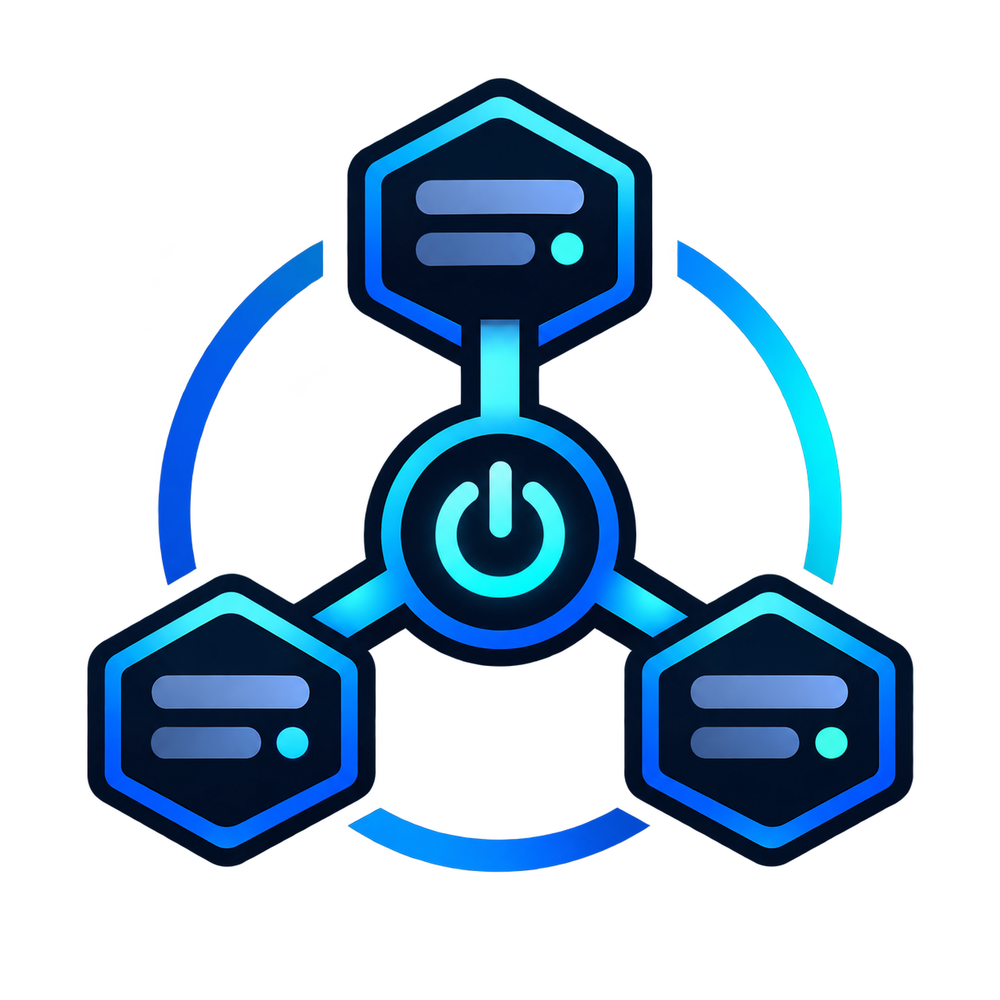
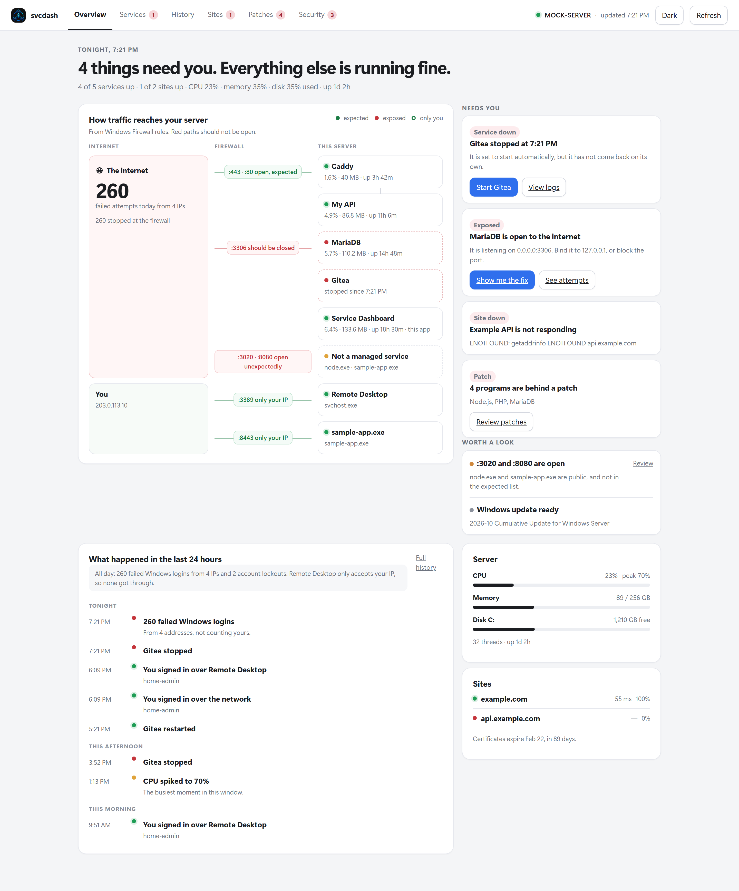
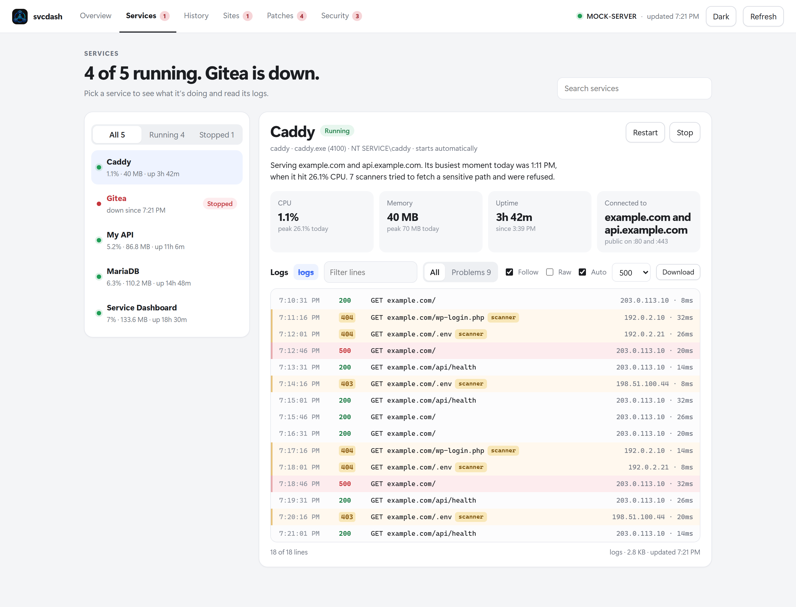
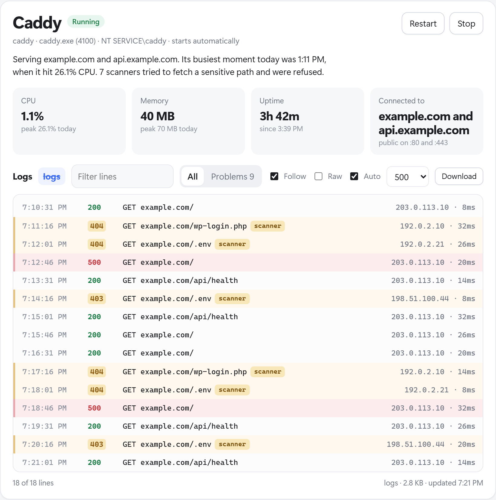
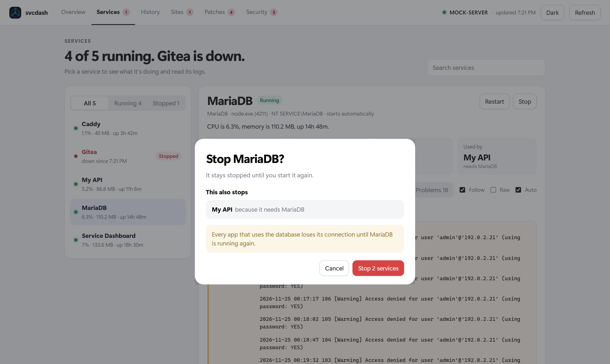
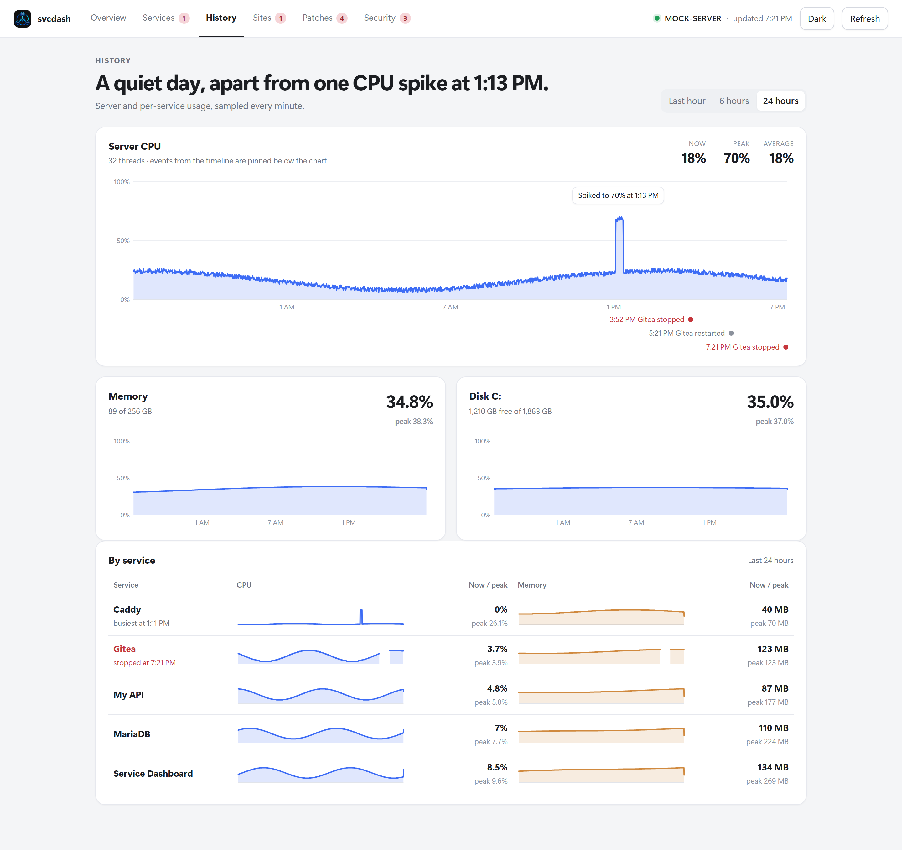
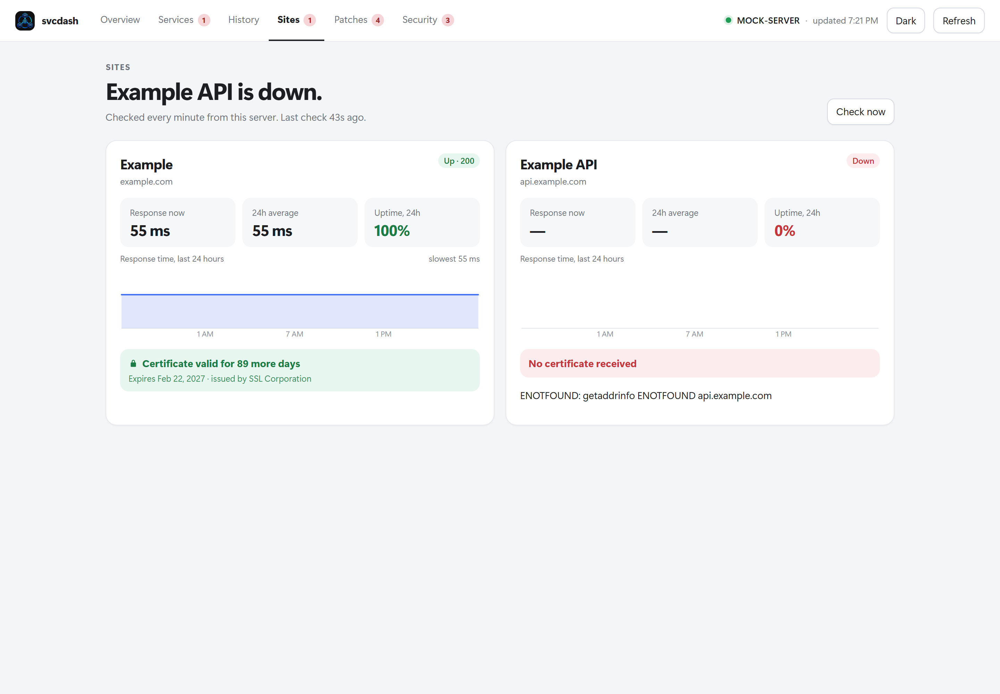
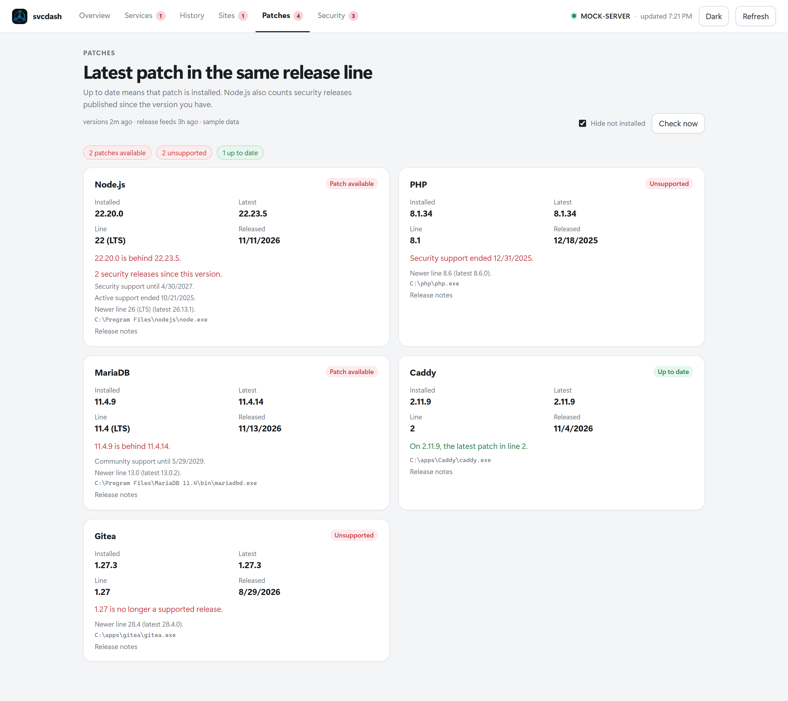
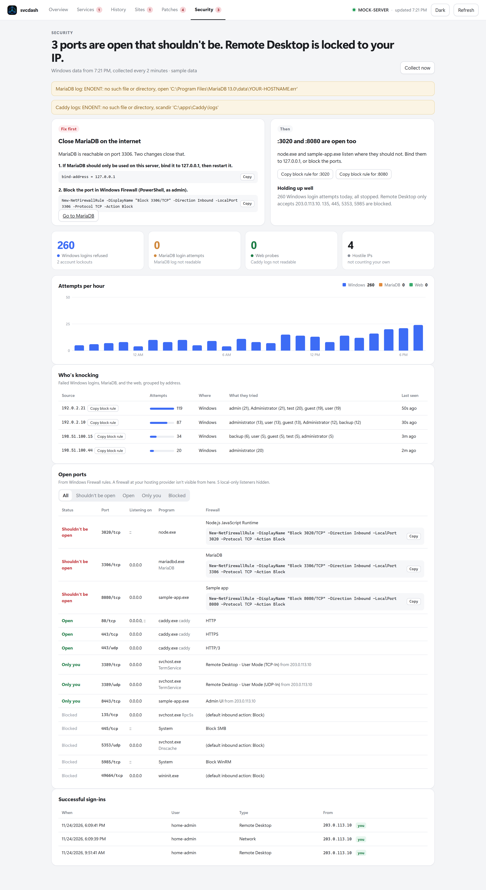

# Service Dashboard

<p align="center">
  
</p>

A small web dashboard for a Windows server. Node.js only, no npm packages.

- **Services:** status, CPU, memory, disk, uptime, pending Windows updates, start/stop/restart, and a live log viewer. A badge on the tab counts services that are stopped or not installed.
- **History:** server CPU, memory and disk, plus CPU and memory per service, sampled every minute and kept for 24 hours.
- **Sites:** each URL in the config, checked every minute, with status, response time, uptime and certificate expiry. A badge counts sites that are down or have a certificate inside 14 days.
- **Security:** which ports are reachable from the internet and why, plus a 24-hour attack summary (failed Windows/RDP logins, MariaDB login attempts, web scanners). The page warns when the collector has stopped writing.
- **Patches:** installed Node.js, PHP, and other common programs, compared with the latest patch in that release line. The badge counts lines that are behind or out of support. Node.js also shows how many security releases came out since the installed version.

## Screenshots

These were taken with the built-in sample data (`SVCDASH_MOCK=1` and `SVCDASH_SEED=1`), so the header says `MOCK-SERVER` and the addresses are documentation IPs. On a real server those are your machine, your sites, and your logs.

### Overview



The first page. Stopped services, ports that should not be open, and sites that are down are listed under **Needs you**. The map marks paths as expected, exposed, or limited to your IP. Pending Windows updates show under **Worth a look**.

### Services



Select a service to see what it is doing. Start, stop, and restart are on that detail. The dashboard's own service is read-only. The badge on **Services** counts services that are stopped or not installed. The badge on **Security** is how many ports are open to the internet but not listed in `expectedPublicPorts`. The badge on **Sites** counts sites that are down, or whose certificate expires within 14 days (amber when that is the only problem). The badge on **Patches** counts programs that are behind the latest patch in their release line, or out of support.

### Logs



Caddy's JSON access lines are shown as status, method, URL, client, and duration. Client errors and server errors are colored, and probes for sensitive paths get a scanner tag. **Problems** keeps only those lines. **Raw** shows the original text. Press `/` to filter. **Follow**, **Auto**, and **Download** sit on the same row.

### Confirming a stop



Start, stop, and restart all ask first. Services that depend on the one you picked, and are currently running, are listed and stopped or restarted with it.

### History



Hover a chart, or focus it and use the arrow keys. The attack chart on the Security page has the same controls, plus a table view.

### Sites



Checked every minute from the server. **Check now** runs them immediately. The certificate line turns amber within 14 days of expiry, and red within 7. In this sample, `api.example.com` does not resolve, so Example API is down.

### Patches



One card per program. With the sample data, Node.js is behind and has security releases since the installed version, PHP is on a line that is out of support, MariaDB is a few patches behind, Caddy is current, and Gitea is no longer on one of its two newest lines. **Check now** runs the version commands and the release lookup again. **Hide not installed** is on by default.

### Security



Loopback listeners stay out of the ports table, and the note under the filters says how many were hidden. Each unexpected port has **Copy block rule**. Logins from `trustedIps` are tagged "you" and left out of the attack counts. If the collector's file is more than 8 minutes old, a warning says the scheduled task may have stopped; the port and login figures below it are then the last copy, not a live reading. The MariaDB and Caddy warnings in the sample are there because those log paths are not on the machine, and the page still shows MariaDB reachable from outside.

## Files

| Path | Purpose |
|---|---|
| `server.js`, `lib/` | The server. Listens on `127.0.0.1:3090` only. |
| `config.example.json` | Template for services, sites, trusted IPs, expected public ports, and log paths. Copy it to `config.json`. |
| `public/` | The web page. |
| `collect.ps1` | Collector that runs as SYSTEM every 2 minutes (see below). |
| `setup.ps1` | Downloads a GitHub release and installs or updates the server. |
| `install.ps1` | Registers the service, permissions, and collector. The Windows setup program runs this. |
| `installer/` | Builds `ServiceDashboard-Setup.exe` and `ServiceDashboard.dmg`. |
| `state/` | History and site-check data (created by the installer). |
| `collected/` | Collector output (created by the installer). |

## Install or update

Download the installer from the [latest release](https://github.com/JaredScar/LocalServiceManager/releases/latest). Node.js 18 or newer is required on either system.

### Windows

Run [ServiceDashboard-Setup.exe](https://github.com/JaredScar/LocalServiceManager/releases/latest/download/ServiceDashboard-Setup.exe). [nssm](https://nssm.cc/) must be on PATH. The setup program installs to `C:\apps\svcdash`, keeps an existing `config.json`, `state\`, `collected\`, and `logs\`, and registers the service. The dashboard stops for a few seconds while that happens.

On a new server, setup writes `config.json` from the example. Edit that file (use forward slashes in paths), then run `C:\apps\svcdash\install.ps1`:

- **`trustedIps`:** your home IP. Its logins and requests are labeled "you" and left out of the attack counts.
- **`expectedPublicPorts`:** ports that are *meant* to be open to everyone. Anything else that's reachable is flagged as unexpected.
- **`sites`:** URLs to check every minute.
- **`attackSources`:** the MariaDB error log and the Caddy log folder.
- **`notify`:** optional. `url` is where to POST when something changes (a service stops or starts, a site goes down or comes back, a certificate crosses 14 or 7 days, an unexpected port appears or clears, the collector goes quiet, or an installed program falls behind its latest patch, drops out of security support, or is current again). `token` is sent as a bearer token when the receiver needs one. Leave `url` empty to stay silent. Discord, Slack, and ntfy URLs are recognized; anything else gets a JSON body with `message`, `text`, and `content`. The current state is saved first and is not sent, so restarting the dashboard does not repeat it.
- **`patches`:** optional. Leave it out and the page tracks whichever supported programs are installed. Set it to limit that list, or to point at an exe the search did not find. A listed program that is not there is shown as not installed, and is not counted on the badge. Known ids: `nodejs`, `php`, `mariadb`, `mysql`, `caddy`, `gitea`, `python`, `go`, `nginx`, `postgresql`, `redis`.

Then open http://127.0.0.1:3090. After you only change `config.json`, re-run `C:\apps\svcdash\install.ps1`.

Running the setup program again updates the installation. Windows SmartScreen may warn the first time, because the program is not signed. Choose More info, then Run anyway.

The same release also includes `setup.ps1` if you would rather install from PowerShell.

### Mac

Open [ServiceDashboard.dmg](https://github.com/JaredScar/LocalServiceManager/releases/latest/download/ServiceDashboard.dmg) and drag Service Dashboard to Applications.

The first time macOS blocks it, right-click the app, choose Open, and confirm. On a Mac the service list and the security page use sample data, because controlling Windows services and reading the Windows firewall happen on the server. Site checks from the Mac are real. Settings and history are stored in `~/Library/Application Support/Service Dashboard`.

## How the Security page gets its data

The dashboard runs under its own low-privilege account, which can't read the Windows Security log or the full firewall configuration. Rather than give it more access, `install.ps1` creates a scheduled task, **`\svcdash\svcdash-collector`**, that runs `collect.ps1` as SYSTEM every 2 minutes and writes `collected\security.json`.

- The dashboard can only *read* that folder.
- Only administrators can edit `collect.ps1`, so the dashboard can't change what runs as SYSTEM.
- The collector reads nothing the dashboard writes.

You'll see this task if you list non-Microsoft scheduled tasks. That's expected. Each run also records whether Windows is waiting to reboot, and it searches for pending Windows updates at most once every 6 hours. Pending updates and a waiting reboot show on the overview, under Worth a look. The update search gives up after 45 seconds so it cannot stall the rest of the collection.

**Failed-logon auditing must be on** for failed RDP logins to appear. The page warns if it's off. To enable it:

```powershell
auditpol /set /subcategory:"Logon" /success:enable /failure:enable
wevtutil sl Security /ms:1073741824   # 1 GB Security log, so 24 hours fits
```

## How the Patches page gets its data

The dashboard looks up programs it knows how to identify: Node.js, PHP, MariaDB, MySQL, Caddy, Gitea, Python, Go, nginx, PostgreSQL, and Redis. For each one it finds, it runs that program's version command. The Node.js process the dashboard itself is running is read directly. Nothing is downloaded or installed, and the commands are not taken from config: config can only name a product and, if needed, the full path of its `.exe`.

The version is compared with the current release line. Those lines come from [endoflife.date](https://endoflife.date), except Gitea, which is not in that feed. Gitea uses GitHub's stable releases, and the two newest minor versions count as supported. Node.js also counts releases that nodejs.org marks as security releases, newer than what is installed, in the same major version.

Versions are cached for 10 minutes and release feeds for 6 hours. **Check now** refreshes both. "Up to date" means the latest patch in that release line is installed. It does not mean the program has no open issues. The same changes are included in notifications.

## Exposed ports: what the statuses mean

| Status | Meaning |
|---|---|
| **Open · unexpected** | Reachable from the internet but not in `expectedPublicPorts`. Fix these: bind the app to `127.0.0.1`, or use the row's "Copy block rule" button. |
| **Open** | Reachable from the internet, and expected. |
| **Restricted** | Allowed only from specific IPs (e.g. RDP from your home IP). |
| **Blocked** | A firewall rule, or the default inbound action, blocks it. |
| **Local only** | Listening on `127.0.0.1` only; never reachable from outside. |

This is estimated from Windows Firewall rules. A firewall at your hosting provider isn't visible from the server.

A common surprise: the first time Node.js listens on a port, Windows may create an **"Node.js JavaScript Runtime"** allow rule for *every* port. Any Node app listening on all interfaces then becomes public. The fix is to make each app listen on `127.0.0.1`, and optionally disable that rule.

## Controlling services

The service you select has **Start**, **Stop**, and **Restart**, all behind a confirmation. Dependent services (e.g. the APIs depend on MariaDB) are listed in the confirmation.

- `"control": false` on a service makes it read-only.
- `"allowControl": false` makes the whole dashboard read-only.
- The dashboard can't restart itself; use `Restart-Service svcdash`.
- Every action is logged to `logs/audit.log`, viewable from the Service Dashboard card.

## Remote access through Caddy (optional)

1. Point an A record for your status hostname (for example `status.example.com`) at the server.
2. Create a password hash: `C:\apps\Caddy\caddy.exe hash-password`
3. Add that hostname to `allowedHosts` in `config.json`, and add this to the Caddyfile. Replace the IP with your home address and `admin` with your username:
   ```caddyfile
   status.example.com {
   	import security
   	route {
   		@notme not remote_ip 203.0.113.10
   		respond @notme 403
   		basic_auth {
   			admin PASTE_HASH_HERE
   		}
   		reverse_proxy 127.0.0.1:3090 {
   			header_up X-Auth-User {http.auth.user.id}
   		}
   	}
   	log {
   		output file C:/apps/Caddy/logs/status.log
   	}
   }
   ```
4. `caddy validate`, then `Restart-Service caddy`.

Keep it behind both the IP allowlist and the password; this dashboard can restart services.

## Notes

- History and site results are kept for 24 hours and survive restarts.
- The header theme button switches between Dark and Light. With nothing saved, the page follows the system theme.

## Publishing

`config.json` is gitignored. It holds your domains, home IP, hostname, and log paths, so commit `config.example.json` instead. `state/`, `collected/`, and `logs/` are created on the server and are ignored too.

Pushing a tag such as `v1.0.1` publishes a GitHub release. The release contains `ServiceDashboard-Setup.exe`, `ServiceDashboard.dmg`, `setup.ps1`, and `LocalServiceManager.zip`.
