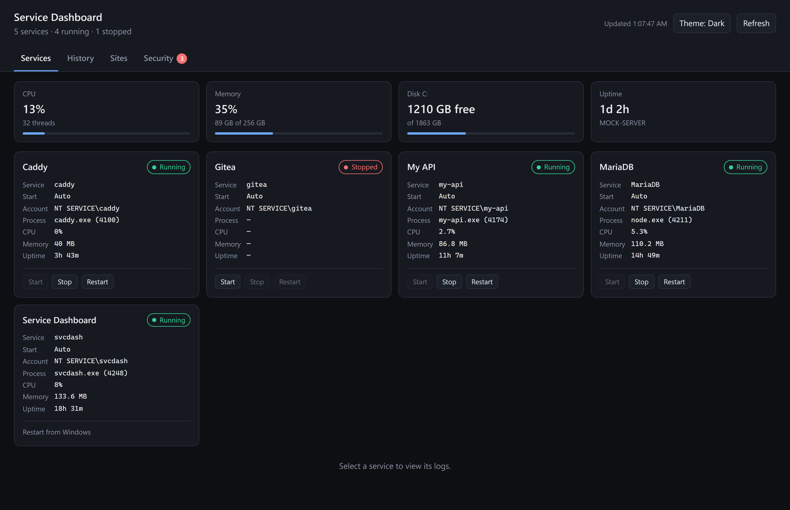
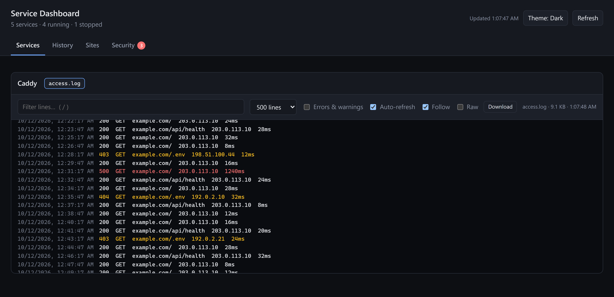
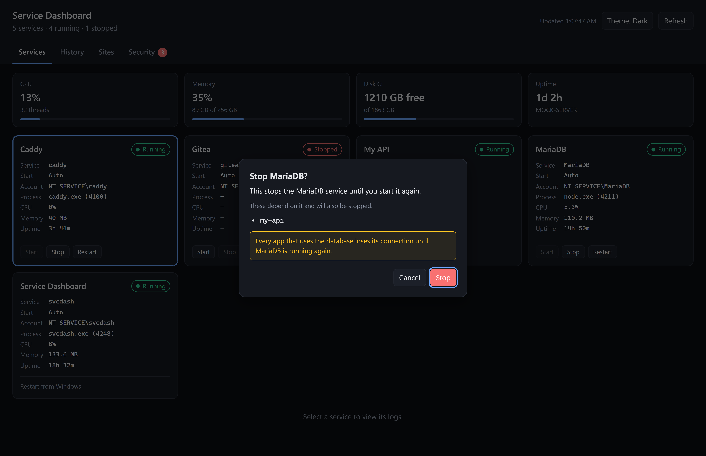
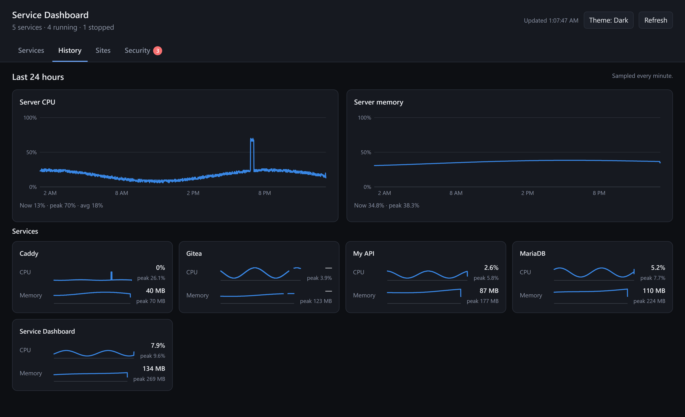
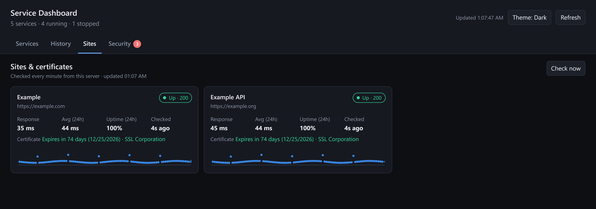

# Service Dashboard

A small web dashboard for a Windows server. Node.js only, no npm packages.

- **Services:** status, CPU, memory, uptime, start/stop/restart, and a live log viewer.
- **History:** server CPU and memory, plus CPU and memory per service, sampled every minute and kept for 24 hours.
- **Sites:** each URL in the config, checked every minute, with status, response time, uptime and certificate expiry.
- **Security:** which ports are reachable from the internet and why, plus a 24-hour attack summary (failed Windows/RDP logins, MariaDB login attempts, web scanners).

## Screenshots

These were taken with the built-in sample data (`SVCDASH_MOCK=1` and `SVCDASH_SEED=1`), so the uptime tile says `MOCK-SERVER` and the addresses are documentation IPs. On a real server those are your machine, your sites, and your logs.

### Services



One card per service. The dashboard's own card is read-only ("Restart from Windows"). The red badge on **Security** is how many ports are open to the internet but not listed in `expectedPublicPorts`.

### Logs



Click a card to tail its logs. Caddy's JSON access lines are shown as status, method, URL, client, and duration. Errors and warnings are colored. Press `/` to filter. There is also an errors-only toggle, raw JSON, and download.

### Confirming a stop



Start, stop, and restart all ask first. Services that depend on the one you picked, and are currently running, are listed and stopped or restarted with it.

### History



Hover a chart, or focus it and use the arrow keys. The attack chart on the Security page has the same controls, plus a table view.

### Sites



Checked every minute from the server. **Check now** runs them immediately. The certificate line turns amber within 14 days of expiry, and red within 7.

### Security


**Hide local-only** is on by default, so loopback listeners stay out of the way. Each unexpected address has **Copy block rule**. Logins from `trustedIps` are tagged "you" and left out of the attack counts. The warning at the top is there because the sample shows MariaDB reachable from outside.

## Files

| Path | Purpose |
|---|---|
| `server.js`, `lib/` | The server. Listens on `127.0.0.1:3090` only. |
| `config.example.json` | Template for services, sites, trusted IPs, expected public ports, and log paths. Copy it to `config.json`. |
| `public/` | The web page. |
| `collect.ps1` | Collector that runs as SYSTEM every 2 minutes (see below). |
| `install.ps1` | Installs or updates everything. |
| `state/` | History and site-check data (created by the installer). |
| `collected/` | Collector output (created by the installer). |

## Install or update

1. Copy this folder to `C:\apps\svcdash`, overwriting the old files. Leave your existing `config.json` in place if you already have one.
2. Otherwise copy `config.example.json` to `config.json`, then edit it (use forward slashes in paths):
   - **`trustedIps`:** your home IP. Its logins and requests are labeled "you" and left out of the attack counts.
   - **`expectedPublicPorts`:** ports that are *meant* to be open to everyone. Anything else that's reachable is flagged as unexpected.
   - **`sites`:** URLs to check every minute.
   - **`attackSources`:** the MariaDB error log and the Caddy log folder.
3. In an **elevated** PowerShell:
   ```powershell
   Get-ChildItem C:\apps\svcdash -Recurse | Unblock-File
   Set-ExecutionPolicy -Scope Process Bypass
   C:\apps\svcdash\install.ps1
   ```
4. On the server, open http://127.0.0.1:3090.

Re-run `install.ps1` whenever you change `config.json`.

## How the Security page gets its data

The dashboard runs under its own low-privilege account, which can't read the Windows Security log or the full firewall configuration. Rather than give it more access, `install.ps1` creates a scheduled task, **`\svcdash\svcdash-collector`**, that runs `collect.ps1` as SYSTEM every 2 minutes and writes `collected\security.json`.

- The dashboard can only *read* that folder.
- Only administrators can edit `collect.ps1`, so the dashboard can't change what runs as SYSTEM.
- The collector reads nothing the dashboard writes.

You'll see this task if you list non-Microsoft scheduled tasks. That's expected.

**Failed-logon auditing must be on** for failed RDP logins to appear. The page warns if it's off. To enable it:

```powershell
auditpol /set /subcategory:"Logon" /success:enable /failure:enable
wevtutil sl Security /ms:1073741824   # 1 GB Security log, so 24 hours fits
```

## Exposed ports: what the statuses mean

| Status | Meaning |
|---|---|
| **Open · unexpected** | Reachable from the internet but not in `expectedPublicPorts`. Fix these: bind the app to `127.0.0.1`, or use the row's "Copy block rule" button. |
| **Open** | Reachable from the internet, and expected. |
| **Restricted** | Allowed only from specific IPs (e.g. RDP from your home IP). |
| **Blocked** | A firewall rule, or the default inbound action, blocks it. |
| **Local only** | Listening on `127.0.0.1` only; never reachable from outside. |

This is estimated from Windows Firewall rules. A firewall at your hosting provider isn't visible from the server.

A common surprise: the first time Node.js listens on a port, Windows may create an **"Node.js JavaScript Runtime"** allow rule for *every* port. Any Node app listening on all interfaces then becomes public. The fix is to make each app listen on `127.0.0.1`, and optionally disable that rule.

## Controlling services

Each service card has **Start**, **Stop** and **Restart**, all behind a confirmation. Dependent services (e.g. the APIs depend on MariaDB) are listed in the confirmation.

- `"control": false` on a service makes it read-only.
- `"allowControl": false` makes the whole dashboard read-only.
- The dashboard can't restart itself; use `Restart-Service svcdash`.
- Every action is logged to `logs/audit.log`, viewable from the Service Dashboard card.

## Remote access through Caddy (optional)

1. Point an A record for your status hostname (for example `status.example.com`) at the server.
2. Create a password hash: `C:\apps\Caddy\caddy.exe hash-password`
3. Add that hostname to `allowedHosts` in `config.json`, and add this to the Caddyfile. Replace the IP with your home address and `admin` with your username:
   ```caddyfile
   status.example.com {
   	import security
   	route {
   		@notme not remote_ip 203.0.113.10
   		respond @notme 403
   		basic_auth {
   			admin PASTE_HASH_HERE
   		}
   		reverse_proxy 127.0.0.1:3090 {
   			header_up X-Auth-User {http.auth.user.id}
   		}
   	}
   	log {
   		output file C:/apps/Caddy/logs/status.log
   	}
   }
   ```
4. `caddy validate`, then `Restart-Service caddy`.

Keep it behind both the IP allowlist and the password; this dashboard can restart services.

## Notes

- History and site results are kept for 24 hours and survive restarts.
- The header theme button cycles Dark, Light, and Auto.

## Publishing

`config.json` is gitignored. It holds your domains, home IP, hostname, and log paths, so commit `config.example.json` instead. `state/`, `collected/`, and `logs/` are created on the server and are ignored too.
